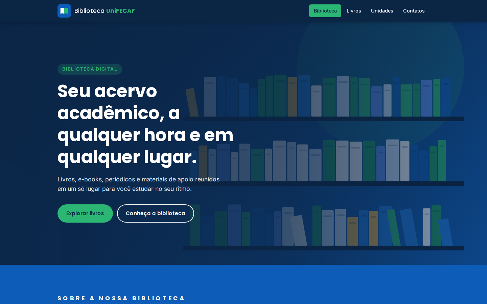
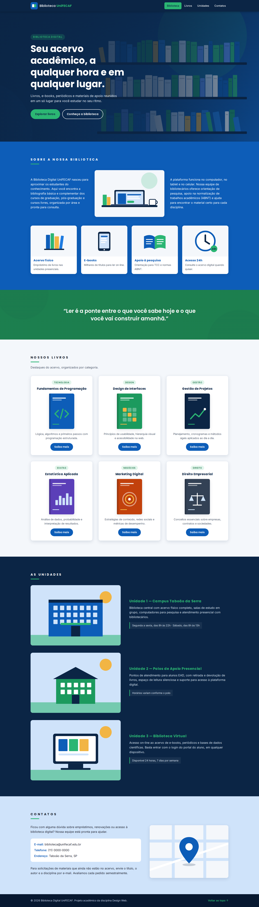
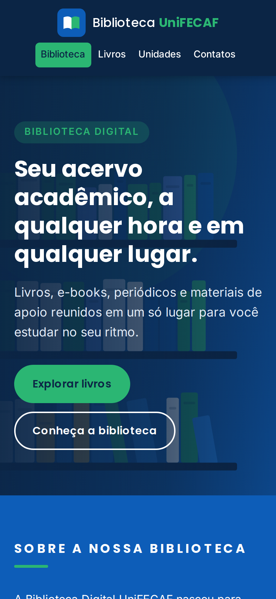
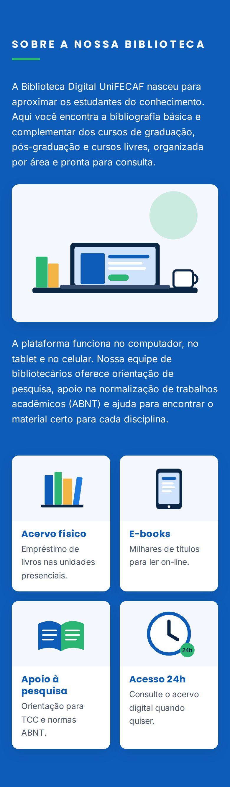
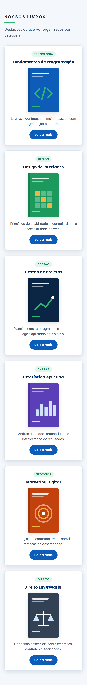
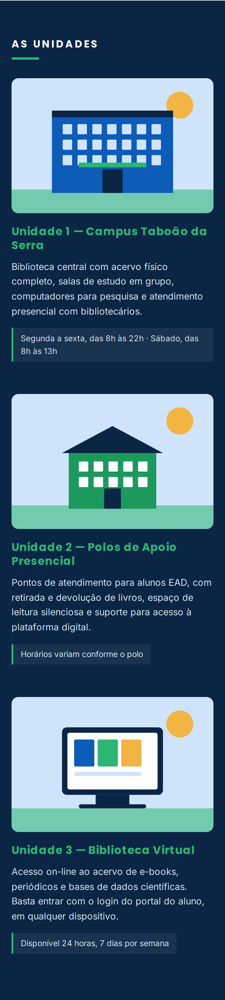
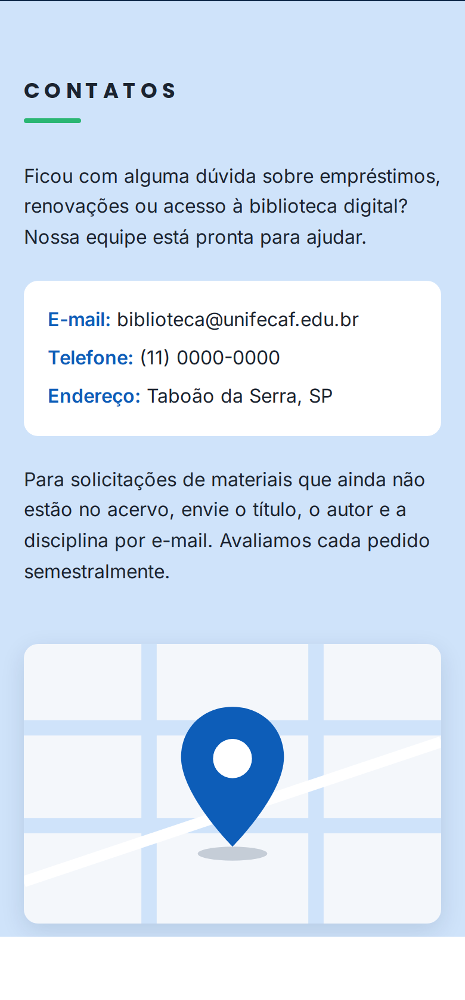

# Biblioteca Digital UniFECAF — Relatório do Projeto

**Disciplina:** Design Web
**Aluno:** Danilo Oliveira
**Site publicado:** https://devdanilooliveira.github.io/biblioteca-unifecaf/
**Repositório:** https://github.com/DevDaniloOliveira/biblioteca-unifecaf

---

## 1. Análise do problema e do protótipo

A UniFECAF precisa da primeira interface web da sua nova Biblioteca Digital. O objetivo desta etapa não é construir todas as funcionalidades (busca, login, empréstimos), e sim transformar um protótipo de baixa fidelidade em uma página real, organizada, responsiva e alinhada à identidade da instituição, usando apenas HTML e CSS.

O protótipo é um wireframe em tons de cinza com blocos de imagem genéricos e texto *lorem ipsum*. Ele define **o que** a página deve ter e **em que ordem**, mas não define cores, tipografia, conteúdo nem comportamento em telas pequenas. Da análise, identifiquei oito blocos:

| # | Bloco do protótipo | Como aparece no wireframe |
|---|---|---|
| 1 | Menu | Barra preta com 4 links à direita (Biblioteca ativo, Livros, Unidades, Contatos) |
| 2 | Imagem principal | Faixa larga com imagem |
| 3 | Sobre a nossa biblioteca | Fundo escuro, texto · imagem · texto, e abaixo 4 imagens pequenas |
| 4 | Imagem intermediária | Faixa larga com imagem |
| 5 | Nossos livros | 6 cards (3 × 2) com nome, imagem, texto e botão "Saiba mais" |
| 6 | As unidades | Fundo preto, 3 linhas com imagem à esquerda e texto à direita |
| 7 | Contatos | Fundo cinza claro, texto à esquerda e imagem à direita |
| 8 | Rodapé | Barra preta |

Pontos que o protótipo deixa em aberto e que precisei decidir:

- **Identidade visual:** o wireframe é preto e cinza; o site precisava das cores da UniFECAF.
- **Conteúdo real:** os textos e imagens são marcadores; criei textos coerentes com uma biblioteca acadêmica e ilustrações próprias.
- **Função das imagens pequenas e das faixas:** interpretei as 4 imagens do "Sobre" como os **serviços** da biblioteca, a faixa do topo como um *hero* com chamada principal e a faixa intermediária como um banner com uma mensagem institucional.
- **Versão mobile:** o protótipo só mostra o desktop, então defini como cada bloco se reorganiza no celular.

## 2. Público-alvo

- **Principal:** estudantes de graduação, pós-graduação e cursos livres da UniFECAF, presenciais e EAD, de 17 a 45 anos. Muitos estudam à noite ou trabalham, então acessam principalmente **pelo celular** e em horários variados.
- **Secundário:** professores e coordenadores que consultam a bibliografia das disciplinas.

Consequências para o projeto: leitura rápida (textos curtos e títulos claros), navegação simples com poucos itens, layout pensado primeiro para o celular e destaque para o acesso 24h e para as unidades/polos (importante para o aluno EAD).

## 3. Paleta de cores e tipografia

### 3.1 Paleta

A paleta parte das duas cores da marca UniFECAF — **azul** e **verde** — vistas no logotipo e nos materiais institucionais. As demais cores são variações para criar contraste e hierarquia, e todas estão declaradas como variáveis CSS em `:root`, o que garante consistência entre os componentes.

| Variável | Cor | Uso |
|---|---|---|
| `--azul-marinho` | `#0B2545` | Menu, seção Unidades, textos de botão verde (substitui o preto do protótipo) |
| `--azul` | `#0D5DB8` | Cor principal: seção Sobre, botões "Saiba mais", títulos de cards |
| `--azul-claro` | `#CFE3FA` | Fundo da seção Contatos (substitui o cinza claro do protótipo) |
| `--verde` | `#2BB673` | Destaques: item ativo do menu, botão principal, barra sob os títulos |
| `--verde-escuro` | `#1C7A4C` | Banner e etiquetas de categoria |
| `--cinza-fundo` | `#F4F7FB` | Fundo da seção Livros |
| `--texto` | `#1B2430` | Texto sobre fundos claros |
| `--texto-suave` | `#4A5568` | Descrições e textos secundários |

**Contraste (WCAG 2.1):** todas as combinações de texto foram calculadas e passam do nível AA (mínimo 4,5:1):

| Combinação | Contraste |
|---|---|
| Texto `#1B2430` sobre branco | 15,65 : 1 |
| Branco sobre azul-marinho | 15,39 : 1 |
| Texto sobre azul-claro (Contatos) | 11,94 : 1 |
| Texto suave sobre cinza-fundo | 7,00 : 1 |
| Branco sobre azul (seção Sobre, botões) | 6,41 : 1 |
| Verde sobre azul-marinho / azul-marinho sobre verde | 5,89 : 1 |
| Branco sobre verde-escuro (banner) | 5,33 : 1 |
| Verde-escuro sobre `#E3F5EC` (categorias) | 4,71 : 1 |

Uma decisão importante: o verde da marca (`#2BB673`) com texto **branco** teria contraste de apenas ~2,6:1, então nos botões verdes o texto é **azul-marinho**, e o banner usa o **verde-escuro** com texto branco.

### 3.2 Tipografia

- **Poppins** (títulos, botões, menu): geométrica e arredondada, é a mesma família usada nos materiais da UniFECAF (inclusive no próprio enunciado do trabalho), o que reforça a identidade.
- **Inter** (textos corridos): desenhada para telas, tem ótima legibilidade em tamanhos pequenos, o que é essencial no celular.

Ambas são carregadas do Google Fonts com fontes de reserva (`"Segoe UI", Arial, sans-serif`) caso não carreguem. O corpo usa 16px com altura de linha 1,6. Os títulos de seção mantêm a característica do protótipo (caixa alta com letras espaçadas), com espaçamento menor no celular para não quebrar em muitas linhas.

## 4. Justificativa das principais decisões visuais

1. **Preto → azul-marinho.** O protótipo usa preto nos blocos escuros. Troquei por azul-marinho: mantém o mesmo peso visual e o contraste alto, mas aproxima o site da marca e deixa a página menos pesada.
2. **Alternância de fundos.** O protótipo alterna faixas claras e escuras. Mantive esse ritmo (azul-marinho → azul → verde → cinza claro → azul-marinho → azul-claro → azul-marinho) para que cada seção seja reconhecida visualmente ao rolar a página.
3. **Verde como cor de ação.** O verde aparece apenas onde há algo importante: item ativo do menu, botão principal, barra sob os títulos e nomes das unidades. Usar a cor com moderação faz com que ela guie o olhar.
4. **Hero com texto.** No protótipo, o topo é só uma imagem. Acrescentei título, descrição e dois botões sobre a imagem, com um degradê escuro por cima para garantir a leitura do texto.
5. **Cards de livros com categoria.** O enunciado pede que o aluno "identifique categorias". Cada card ganhou uma etiqueta (Tecnologia, Design, Gestão…) acima do nome, mantendo o resto da estrutura do protótipo (nome, imagem, texto e botão).
6. **"Saiba mais" funcional sem JavaScript.** O botão usa o elemento nativo `<details>/<summary>`, que abre e fecha uma informação extra (formato, páginas, disponibilidade) apenas com HTML, é acessível por teclado e lido corretamente por leitores de tela.
7. **Ilustrações próprias em SVG.** Todas as imagens foram criadas para o projeto em SVG, usando a mesma paleta do site. Isso evita problemas de direitos autorais, mantém a coerência visual e as imagens ficam nítidas em qualquer tela, com arquivos muito leves.
8. **Cantos arredondados e sombras suaves** em todos os cards e imagens (variáveis `--raio` e `--sombra`), para dar unidade aos componentes e um aspecto moderno.

## 5. Estrutura das seções

O HTML é semântico: cada parte da página usa a tag que descreve sua função.

```
<body>
├── <a class="pular-conteudo">         link de acessibilidade
├── <header class="cabecalho">         logo + <nav> com o menu
├── <main id="conteudo">
│   ├── <section class="hero">         imagem principal + chamada
│   ├── <section id="biblioteca">      Sobre: texto · imagem · texto + 4 serviços (<ul>)
│   ├── <section class="banner">       faixa intermediária com <blockquote>
│   ├── <section id="livros">          6 cards <article> em grade
│   ├── <section id="unidades">        3 <article> imagem + texto
│   └── <section id="contatos">        texto + <address> + imagem
└── <footer class="rodape">            créditos + voltar ao topo
```

Organização dos arquivos, conforme pedido:

```
biblioteca-unifecaf/
├── index.html
├── css/
│   └── style.css
├── assets/
│   └── imagens/        logo, hero, banner, serviços, capas, unidades, contato (SVG)
└── docs/
    ├── relatorio.md
    └── capturas/       prints desktop e mobile
```

O CSS está dividido em blocos numerados e comentados (variáveis, reset, acessibilidade, botões, cabeçalho, hero, seções, sobre, banner, livros, unidades, contatos, rodapé e responsividade). As classes seguem um padrão inspirado em BEM, em português (`.livro`, `.livro__nome`, `.botao--destaque`), para que o nome já indique a qual componente cada estilo pertence.

## 6. Estratégias de responsividade

1. **Mobile-first.** Os estilos base são escritos para o celular, e as telas maiores são tratadas com `@media (min-width: …)`. Assim o celular, o principal dispositivo do público, carrega o layout mais simples.
2. **Dois pontos de quebra:**
   - **600px (tablet):** livros em 2 colunas; unidades com imagem e texto lado a lado.
   - **900px (desktop):** layout fiel ao protótipo, com menu à direita, "Sobre" em 3 colunas, 4 serviços em linha, livros 3 × 2 e contatos em 2 colunas.
3. **CSS Grid e Flexbox.** As grades (`.sobre`, `.servicos`, `.livros`, `.unidade`, `.contatos`) mudam apenas o `grid-template-columns` em cada ponto de quebra; o menu e os botões usam `flex-wrap` para quebrar linha em vez de estourar a tela.
4. **Imagens fluidas sem distorção.** `max-width: 100%; height: auto` em todas as imagens, além de `aspect-ratio` + `object-fit: cover` nas capas e nas fotos das unidades, garantindo proporção correta em qualquer largura. As tags `` têm `width` e `height`, o que evita que a página "pule" enquanto as imagens carregam.
5. **Unidades relativas** (`rem`, `%`, `fr`, `vh`, `ch`) em vez de medidas fixas; o título do hero é limitado a `18ch` e o texto a `46ch` para manter linhas confortáveis de ler.
6. **Menu fixo (`position: sticky`)** com `scroll-padding-top` ajustado por tamanho de tela, para que o título da seção não fique escondido atrás do menu ao clicar nos links.
7. **Proteção contra texto cortado:** `overflow-wrap: anywhere` no bloco de contatos, para que o e-mail quebre em telas estreitas.

**Verificação:** a página foi testada nas larguras de 320, 360, 390, 768, 1024 e 1440px. Em todas, a largura do documento é igual à da tela (sem rolagem horizontal), sem sobreposição de elementos. A partir de 360px o menu cabe em uma linha; em 320px ele quebra em duas linhas de forma organizada.

## 7. Princípios de acessibilidade aplicados

- `lang="pt-BR"` no `<html>`, para que leitores de tela usem a pronúncia correta.
- **Estrutura semântica** (`header`, `nav`, `main`, `section`, `article`, `address`, `footer`) e hierarquia de títulos sem saltos (um `h1`, `h2` por seção, `h3` nos cards).
- Cada `<section>` ligada ao seu título com `aria-labelledby`, e o menu identificado com `aria-label="Menu principal"`.
- **Link "Pular para o conteúdo"**, visível ao receber foco pelo teclado.
- **Foco visível** (`:focus-visible` com contorno verde de 3px) em links e botões.
- **Texto alternativo** descritivo nas imagens com conteúdo; `alt=""` nas imagens decorativas (ícones dos serviços, que já têm título ao lado), para não repetir informação.
- **Contraste AA** em todas as combinações (seção 3.1).
- `aria-current` no item ativo do menu.
- Botão "Saiba mais" com `<details>`, nativamente acessível por teclado e leitor de tela.
- `prefers-reduced-motion`: desativa animações e rolagem suave para quem configurou o sistema para reduzir movimento.
- Áreas de toque confortáveis nos botões e links do menu no celular.

## 8. Respostas às questões orientadoras

**Como transformar um protótipo de baixa fidelidade em uma interface web moderna, responsiva e alinhada à identidade visual da UniFECAF?**

Em quatro etapas, que foram as que segui neste projeto:

1. **Ler o protótipo como estrutura, não como visual.** O wireframe diz quais blocos existem, em que ordem e como se distribuem (por exemplo, "texto · imagem · texto" ou "3 × 2 cards"). Mantive essa organização e a ordem das seções, e preenchi o que estava em aberto (cores, textos, imagens, comportamento no celular) a partir das necessidades do público-alvo.
2. **Traduzir cada bloco para HTML semântico.** Antes de qualquer estilo, montei a página com as tags corretas (`nav`, `section`, `article`, `address`…). Isso garante que o conteúdo faça sentido mesmo sem CSS, ajuda a acessibilidade e facilita a estilização.
3. **Aplicar a identidade com um sistema, não com cores soltas.** Defini a paleta a partir do azul e do verde da UniFECAF, verifiquei o contraste de cada combinação e guardei tudo em variáveis CSS, junto com tipografia, raios e sombras. Cada componente reutiliza essas variáveis, o que gera consistência.
4. **Construir do celular para o desktop.** Com mobile-first, Grid e Flexbox, o mesmo HTML se reorganiza: uma coluna no celular, duas no tablet e o layout do protótipo no desktop, sem textos cortados, imagens distorcidas ou sobreposição.

**Por que manter a organização do protótipo e mudar as cores?**
O protótipo representa uma decisão da instituição sobre o conteúdo e a ordem de leitura, então ele foi respeitado. Já o preto e o cinza são apenas marcadores de baixa fidelidade; substituí-los pelas cores da marca é justamente o trabalho de transformar o wireframe em uma interface final.

**O que torna a interface "moderna"?**
Hierarquia visual clara, espaço em branco generoso, cantos arredondados, sombras suaves, tipografia sem serifa, microinterações discretas (botões e cards que sobem levemente no *hover*) e, principalmente, funcionar bem em qualquer tela e para qualquer pessoa.

## 9. Capturas de tela

### Desktop (1440px)

Primeira dobra:



Página completa:



### Smartphone (390px)

| Início | Sobre | Livros |
|---|---|---|
|  |  |  |

| Unidades | Contatos |
|---|---|
|  |  |

## 10. Observações

Os textos, horários, telefone e e-mail exibidos no site são ilustrativos, criados para este projeto acadêmico. Todas as ilustrações foram produzidas pelo autor em SVG.
